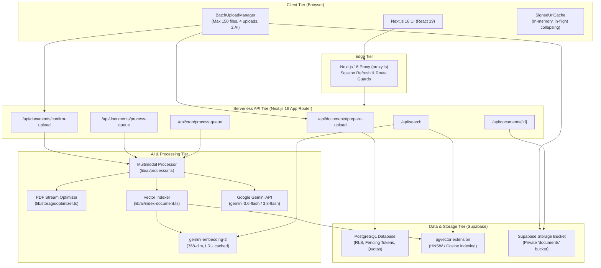

# FileMind — System Architecture & Data Flow

This document details the complete end-to-end architecture, security boundaries, and data processing lifecycles of **FileMind — AI-Powered PDF Vault**.

---

## 🏛️ High-Level Architectural Diagram

---

## 🔄 End-to-End Application Lifecycle

### 1. Authentication & Session Management
- **Provider:** Supabase Auth with PKCE flow supporting Email/Password and Google OAuth.
- **Next.js 16 Proxy (`proxy.ts`):** Intercepts incoming requests on protected routes (`/dashboard`, `/documents`, `/search`, `/settings`). Automatically refreshes expired JWT claims and forwards authentication cookies.
- **Row-Level Security (RLS):** Every database table (`documents`, `document_pages`, `document_metadata`, `document_chunks`) enforces `auth.uid() = user_id`. No user can query or modify another user's records.

---

### 2. PDF Ingestion & Storage Pipeline (150 PDFs / 49 MiB Max)
1. **Selection & Validation (`BatchUploadManager`):**
   - The user drops up to 150 PDF files.
   - Files are validated against `MAX_FILE_SIZE_BYTES` (49 MiB = 51,380,224 bytes) and `ALLOWED_MIME_TYPE` (`application/pdf`).
2. **Pre-Flight Preparation (`/api/documents/prepare-upload`):**
   - Validates CSRF origin (`isSameOrigin`).
   - Checks user storage quota (2 GB limit).
   - Generates a sanitized storage path: `${userId}/${documentId}/${sanitizedFilename}`.
3. **Direct-to-Storage Upload:**
   - Files upload directly to the private Supabase Storage `documents` bucket using a sliding window of **maximum 4 concurrent uploads**.
   - Per-file upload progress is streamed to the reactive UI.
4. **Registration Confirmation (`/api/documents/confirm-upload`):**
   - Reads the uploaded file header to verify `%PDF` magic bytes (`0x25, 0x50, 0x44, 0x46`).
   - Inserts the document record into `public.documents` with `status = 'pending'`.
   - Triggers serverless execution via `after()` or returns for queue pickup.

---

### 3. AI Understanding & Structured Extraction Pipeline
1. **Atomic Claim & Fencing Token:**
   - To prevent race conditions, double processing, and worker conflicts, a worker acquires an atomic processing lease via `claim_next_pending_document()` or `acquire_document_processing()`.
   - Generates a unique UUID fencing token and timestamp lease (`processing_locked_at`).
2. **Safe PDF Stream Optimization (`lib/storage/optimizer.ts`):**
   - Analyzes PDF bytecode using `pdf-lib`.
   - **Guardrails:** Skips reserialization if the PDF contains digital signatures (`/ByteRange`), XFA forms, or encryption to guarantee cryptographic integrity.
   - If optimization saves $\ge 1\%$ space, stores the optimized PDF and updates user quota atomically. If it fails or saves less, cleanly retains the original buffer.
3. **Multimodal Analysis via Gemini:**
   - Uploads the PDF to Google Gemini Files API.
   - Waits for the file state to reach `ACTIVE`.
   - Calls the model with a strict system instruction defending against prompt injection.
   - **Model Cascade:** Uses `gemini-3.6-flash` (verified stable default), cascading to `gemini-3.8-flash`, with bounded exponential backoff on transient errors (503, 429).
   - Extracts structured category, tags, key-value metadata, and page-by-page text.
4. **Atomic Finalization:**
   - Stores pages in `public.document_pages` and metadata in `public.document_metadata`.
   - Atomically transitions document status to `completed` via `finalize_document_processing(p_token)` verifying the fencing token.

---

### 4. Semantic Vector Indexing & Hybrid Search Pipeline
1. **Deterministic Page-Aware Chunking (`lib/ai/chunker.ts`):**
   - Takes extracted page text and produces deterministic chunks (~700–900 tokens, 3,200 chars) with 500-char overlap.
   - Tracks exact start and end page numbers (`page_start`, `page_end`).
2. **Vector Embeddings (`lib/ai/embeddings.ts`):**
   - Produces 768-dimensional dense embeddings using `gemini-embedding-2`.
   - Employs a 500-capacity in-memory LRU cache with SHA-256 key hashing to prevent duplicate embedding API calls.
   - Inserts chunks into `public.document_chunks` with HNSW vector index.
3. **Hybrid Search (`lib/search/hybrid-search.ts`):**
   - Combines dense vector cosine similarity (`match_document_chunks`) with PostgreSQL full-text keyword search (`websearch_to_tsquery`).
   - Employs **Reciprocal Rank Fusion (RRF, $k=60$)** to balance exact identifier matches (e.g. invoice numbers) with semantic conceptual matches.
   - Groups chunk results by document ID, preserves the highest score, and coalesces snippets across matching pages.

---

### 5. Background Queue Draining & Fault Tolerance
- **Autonomous Cron Worker (`/api/cron/process-queue`):**
  - Authenticated strictly via a dedicated `CRON_SECRET` header/bearer token.
  - Multi-user queue claiming via `claim_next_system_pending_document()`.
  - Bounded batch execution ($\le 3$ documents per invocation, 45s hard cutoff) preventing serverless timeouts.
- **Stale Job Recovery:**
  - Documents locked for $>10$ minutes without completion are treated as stale leases.
  - Jobs that fail 3 attempts transition automatically to `failed` with diagnostic logging.
  - Users can manually retry any failed document directly from the UI via `/api/documents/[id]/retry`.
